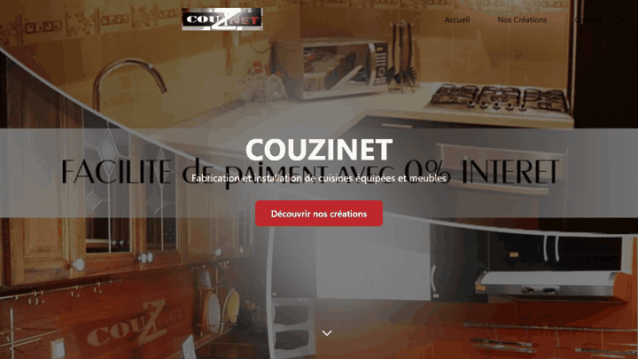
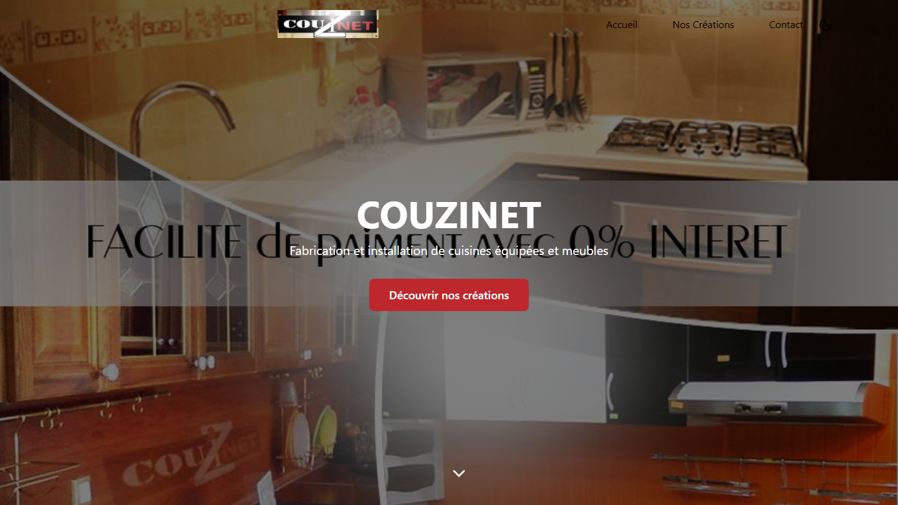
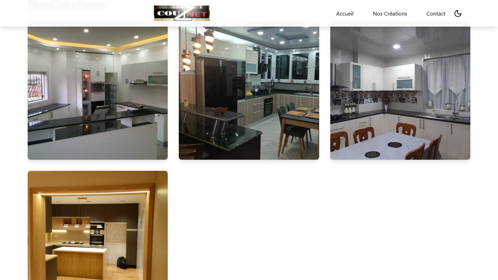
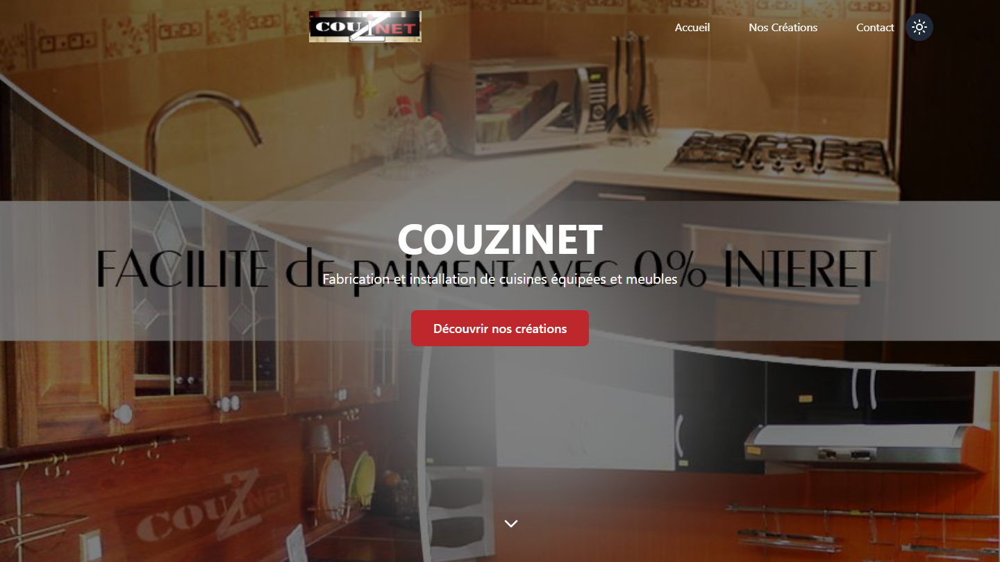
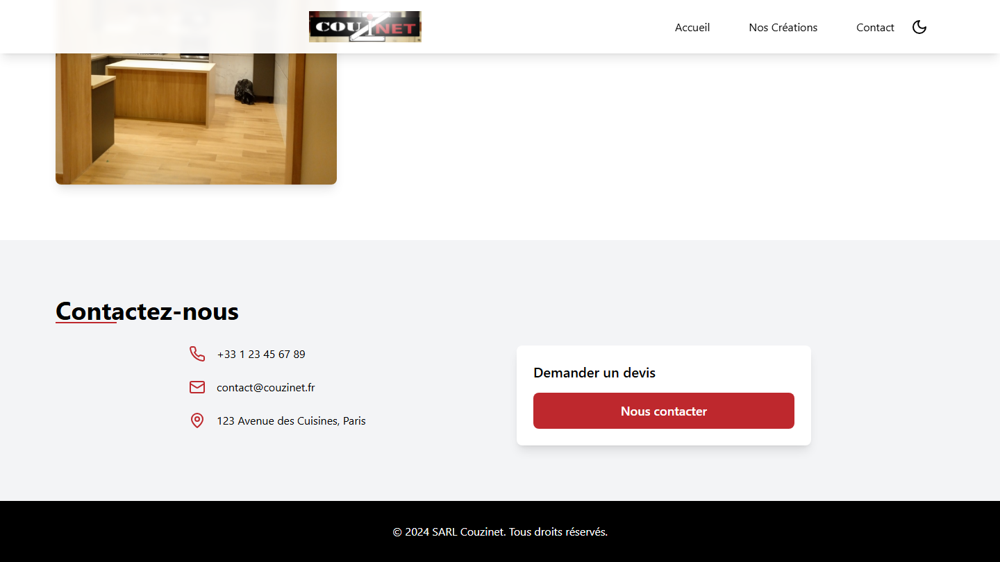

# Couzinet Kitchens

A bilingual-ready, animated single-page showcase site for a fitted-kitchen and furniture workshop, built with React, TypeScript, Tailwind CSS and Framer Motion.




## Features

- Full-screen hero with parallax-style scroll transform and a call-to-action button (content driven by `src/config.ts`)
- Gallery of kitchen realisations with title and description cards
- Letter-by-letter animated section titles, triggered when they scroll into view (`react-intersection-observer` + Framer Motion)
- Sticky header that changes style on scroll
- Light / dark theme toggle
- Contact section (phone, e-mail, address; currently placeholder data)
- Content in French, as the site targets a French-speaking clientele

## Tech stack

React 18, TypeScript, Vite 5, Tailwind CSS 3, Framer Motion, lucide-react icons, ESLint.

## Getting started

```bash
npm install
npm run dev      # http://localhost:5173
npm run build    # production build in dist/
npm run preview
```

## Screenshots

| Hero | Gallery |
|---|---|
|  |  |

| Dark mode | Contact |
|---|---|
|  |  |

## Project structure

```
src/
  App.tsx      # page layout, sections, animations
  config.ts    # hero content (title, description, background, button text)
  types.ts     # shared TypeScript types
  index.css    # Tailwind layers and custom styles
public/        # hero image, kitchen photos, logo
docs/          # screenshots and demo GIF
```

## Notes

- The contact details in the footer section are placeholders, not real business data.
- Project history started as a Bolt-generated scaffold and was then customised by hand with the client's photos and copy.

## Author

Hannoun Amine Amar, Algeria
[LinkedIn](https://www.linkedin.com/in/hannoun-amine/) | hannoun.amine25@gmail.com

Licensed under the MIT License.
