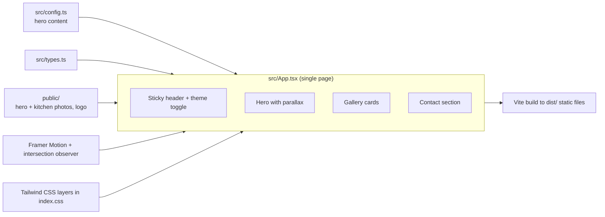

<p align="center">
  
</p>

<p align="center">
  
</p>

<p align="center">
  
  
  
  
  
  
  
</p>

<p align="center">
  
</p>

## Table of contents

- [Overview](#-overview)
- [Features](#-features)
- [Screenshots](#-screenshots)
- [Architecture](#-architecture)
- [Tech stack](#-tech-stack)
- [Requirements](#-requirements)
- [Installation and configuration](#-installation-and-configuration)
- [Usage](#-usage)
- [Project structure](#-project-structure)
- [Testing](#-testing)
- [Troubleshooting and FAQ](#-troubleshooting-and-faq)
- [Roadmap](#-roadmap)
- [Contributing](#-contributing)
- [License](#-license)
- [Author](#-author)

## 🧭 Overview

**Problem.** A fitted-kitchen and furniture workshop needed an online presence that shows its realisations well, without a heavy CMS.

**Solution.** A lightweight, animated single-page site: a full-screen hero, a gallery of kitchen realisations, a contact section and a light/dark toggle. It is a static front end (no back end, no database, no API keys), content is in French as the site targets a French-speaking clientele.

## ✨ Features

- Full-screen hero with parallax-style scroll transform and a call-to-action button (content driven by `src/config.ts`)
- Gallery of kitchen realisations with title and description cards
- Letter-by-letter animated section titles, triggered when they scroll into view (`react-intersection-observer` + Framer Motion)
- Sticky header that changes style on scroll
- Light / dark theme toggle
- Contact section (phone, e-mail, address; currently placeholder data)
- Content in French, as the site targets a French-speaking clientele

## 📸 Screenshots

| Hero | Gallery |
|---|---|
|  |  |

| Dark mode | Contact |
|---|---|
|  |  |

## 🏗 Architecture



## 🧰 Tech stack

| Layer | Tools |
| --- | --- |
| UI | React 18, TypeScript 5 |
| Build | Vite 5 |
| Styling | Tailwind CSS 3, PostCSS, Autoprefixer |
| Animation | Framer Motion 11, react-intersection-observer |
| Icons | lucide-react |
| Quality | ESLint 9 with typescript-eslint |

## 📋 Requirements

| Item | Requirement |
| --- | --- |
| OS | Windows, macOS or Linux |
| Node.js | 18 or newer (Vite 5); 20 LTS recommended. npm |
| Database / services | None |
| Hardware | No GPU or special hardware |
| Ports | `5173` (Vite dev server), `4173` (`vite preview`) |
| Accounts / API keys | None |
| Environment variables | None |

## ⚙ Installation and configuration

```bash
git clone https://github.com/ORD1STAR/couzinet-kitchens.git
cd couzinet-kitchens
npm install
npm run dev        # http://localhost:5173
```

To change the hero title, description, background image or button text, edit `src/config.ts`. Replace the photos in `public/` (`hero.jpg`, `C1.jpg` to `C4.jpg`, `Logo.png`) to use your own images. Gallery entries and contact details are defined in `src/App.tsx`.

## 🚀 Usage

| Command | Purpose |
| --- | --- |
| `npm run dev` | Start the dev server with hot reload |
| `npm run build` | Production build in `dist/` |
| `npm run preview` | Serve the production build locally |
| `npm run lint` | Run ESLint |

The `dist/` folder is plain static files and can be hosted on any static host.

## 🗂 Project structure

<details>
<summary><b>Show tree</b></summary>

```
src/
  App.tsx      # page layout, sections, animations
  config.ts    # hero content (title, description, background, button text)
  types.ts     # shared TypeScript types
  index.css    # Tailwind layers and custom styles
public/        # hero image, kitchen photos, logo
docs/          # screenshots and demo GIF
```

</details>

## 🧪 Testing

There is no automated test suite. Quality checks available:

```bash
npm run lint
npm run build
```

## 🩺 Troubleshooting and FAQ

<details>
<summary><b>Port 5173 is already in use</b></summary>

Vite automatically picks the next free port and prints it in the terminal. Or stop the other process.

</details>

<details>
<summary><b>Images do not show after replacing them</b></summary>

Images are served from `public/` by absolute path (for example `/hero.jpg`). Keep the file names, or update the paths in `src/config.ts` and `src/App.tsx`.

</details>

<details>
<summary><b>Are the contact details real?</b></summary>

No. The phone, e-mail and address in the contact section are placeholders, not real business data.

</details>

## 🗺 Roadmap

- [x] Hero, gallery, contact section
- [x] Light / dark theme toggle
- [x] Scroll-triggered letter animations
- [ ] Working quote request form (the "Nous contacter" button is not wired to anything yet)
- [ ] Real contact details and gallery content from the client
- [ ] Bilingual content (the project is structured for it, only French is provided)

The project history started as a Bolt-generated scaffold and was then customised by hand with the client's photos and copy.

## 🤝 Contributing

Issues and pull requests are welcome. Please run `npm run lint` and `npm run build` before opening a PR.

## 📄 License

Released under the [MIT License](LICENSE).

## 👤 Author

<table>
  <tr>
    <td><b>Hannoun Amine Amar</b><br/>AI Engineer / Fullstack Developer, Algeria</td>
    <td>
      <a href="https://www.linkedin.com/in/hannoun-amine/"></a>
      <a href="mailto:hannoun.amine25@gmail.com"></a>
      <a href="https://github.com/ORD1STAR"></a>
    </td>
  </tr>
</table>

<p align="center">
  
</p>
